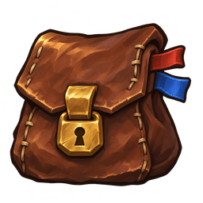

# BagMarks

Mark what you want to keep, sell, or mail, right in your WoW Forever bags.

Works with Blizzard bags and banks, plus EllesmereUI Bags.

## Mark your items

Open your bags, hold **Ctrl + Shift**, and **Right Click** an item to choose a mark:

| Mark | Icon | Purpose |
| --- | --- | --- |
| Locked | Gold padlock | Help protect the item from loss |
| Junk | Red trash can | Set aside for selling |
| Mail | Blue envelope | Set aside for mailing |
| Clear Mark | None | Remove the mark |

From left to right: **Mail**, **Junk**, **Locked**, and **Normal** (unmarked), using the Colorful theme.

The menu checks your current mark. Repeat the shortcut to change or clear it. Identical copies keep separate marks.

## Configure BagMarks

Type **`/bm`** or **`/bagmarks`**, or **Left Click** the minimap button, to open settings.

| Tab | What you can change |
| --- | --- |
| **General** | Enable BagMarks, show the minimap button, set up automatic junk selling, and configure mail autofill |
| **Marking** | Choose mouse controls, a key to cycle the hovered item, and a key to toggle Item Marking Mode |
| **Appearance** | Choose small or full-size marks, toggle icons and tooltip labels, and preview three icon themes |

The minimap button, icons, and tooltip labels start on, with **Colorful** selected. Theme and visibility changes apply immediately. **Left-drag** the minimap button to move it.

**Larger marks:** Choose **Appearance → Mark size → Full item icon** to fill each marked item's icon square with a translucent symbol. The item artwork remains visible underneath. **Small corner** is the default. Size changes made during combat apply when combat ends.

**Marking controls:** The default is **Ctrl + Shift + Right Click**. Change the modifier combination and mouse button in **Marking** to suit your setup. **None** needs no modifier; **Marking Mode only** enables marking only while the mode is on.

**Upgrading?** Your saved shortcut is kept. To switch to the new default, select **Marking → Modifier keys → Ctrl + Shift** and **Mouse button → Right Click**.

**Cycle marks:** Set **Marking → Click action → Cycle marks** to rotate **Normal → Locked → Junk → Mail → Normal** with each marking click. An unmarked item locks first.

**Hover and press a key:** Under **Marking → Keyboard shortcut**, select **Cycle hovered item**, click **Set Key**, and press an unused key or combination. Then point at an item and press that key to cycle its mark. This works with Item Marking Mode off. Combined or changed stacks ask you to choose a stack or mark.

Both **Cycle hovered item** and **Toggle marking mode** start **unbound**. Select either to set its key. Escape cancels capture, **Clear** removes that binding, and **Restore** undoes its last change this session. Existing shortcuts are never replaced. To use **Space**, first move Jump to another key in WoW's Key Bindings. The assigned hover key is reserved for BagMarks even away from items.

## Mark several items quickly

**Right Click** the minimap button, use **`/bm mode`**, or use the settings footer to toggle Item Marking Mode. It uses your selected mouse button without a modifier: plain right-click by default.

The footer shows **ON/OFF** and explains your current controls. A blue minimap indicator and a small **Marking** badge beside the pointer over bag items show when the mode is active. Turn it off to restore your usual clicks. It starts off and switches off on login, `/reload`, or entering combat.

## Sell marked junk

Visit a merchant, click **Sell Marked Junk**, and confirm the preview of up to 12 stacks. Only eligible items marked **Junk** are sold.

Enable **General → Automatically sell marked junk** to sell without confirmation from your next merchant visit. This starts **off**. Click **Stop Selling** to keep remaining items. Locked, Mail, and unmarked items are excluded.

## Mail marked items

1. In **General**, enter a **Default recipient**, using `Character` or `Character-Realm`.
2. Enable **Automatically fill mail recipient** (on by default). It fills empty recipients and preserves replies and typed names.
3. At a mailbox, open **Send Mail** and click **Attach Marked Items**.
4. Review the recipient and attachments, then click Blizzard's **Send** button yourself.

The helper attaches eligible **Mail** items while space remains. Bound items are skipped; unsent items keep their marks.

## A few things to know

- **Locked items:** Reusable items can still be used with merchant, mail, trade, bank, and auction windows closed. Bag sorting can reposition them while keeping their mark. Clear the mark before manually moving or transferring them. Some actions and addons bypass protection; see the [protection limits](docs/API_COMPATIBILITY.md).
- **Saved choices:** Settings are shared across characters; marks belong to each character and follow bag movements. Check marks after splitting or merging stacks.
- **Combat:** Marking, keybinding changes, and sale/mail helpers pause. Settings remain accessible. Existing icons stay visible when readable; new slots may wait until combat ends.
- **EllesmereUI Bags:** Keep the icon column visible in List view. Combined stacks let you choose which individual stack to mark.

## Commands

| Command | Action |
| --- | --- |
| `/bm` or `/bagmarks` | Open or close settings |
| `/bm mode` | Toggle Item Marking Mode |
| `/bm minimap` | Show or hide the minimap button |
| `/bm theme` | Cycle icon themes |
| `/bm reset` | Reset settings after confirmation; keep marks and keybindings |
| `/bm debug` or `/bmcheck` | Open a copyable status report |
| `/bm help` | Show the command list |

## Help improve BagMarks

[Browse the code](https://github.com/Landmine-1252/bagmarks), [report a bug or suggest a feature](https://github.com/Landmine-1252/bagmarks/issues), or fork the repository and [open a pull request](https://github.com/Landmine-1252/bagmarks/pulls).

When reporting an issue, run **`/bm debug`** (or **`/bmcheck`**), click **Select all**, and press **Ctrl+C**. Include the report with your bag addon, what you tried, and what happened.

[What's new](CHANGELOG.md) · [MIT license](LICENSE)

**Installing or updating?** Get the addon ZIP from [GitHub Releases](https://github.com/Landmine-1252/bagmarks/releases), extract its **BagMarks** folder into `Interface/AddOns`, and restart WoW. Replace the old folder to update; settings and marks are kept.
