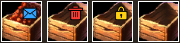

# BagMarks

Mark what you want to keep, sell, or mail, right in your WoW Forever bags.

Works with Blizzard bags and banks, plus EllesmereUI Bags.

## Mark your items

Open your bags and **Alt + Right Click** an item to choose a mark:

| Mark | Icon | Purpose |
| --- | --- | --- |
| Locked | Gold padlock | Help protect the item from loss |
| Junk | Red trash can | Set aside for selling |
| Mail | Blue envelope | Set aside for mailing |
| Clear Mark | None | Remove the mark |

From left to right: **Mail**, **Junk**, **Locked**, and **Normal** (unmarked), using the Colorful theme.

The menu checks your current mark. Repeat the shortcut to change or clear it. Identical copies keep separate marks.

## Configure BagMarks

Type **`/bm`** or **`/bagmarks`**, or **Left Click** the minimap button, to open settings.

| Tab | What you can change |
| --- | --- |
| **General** | Enable BagMarks, show the minimap button, set up automatic junk selling, and configure mail autofill |
| **Marking** | Choose modifier keys, a mouse button, the click action, and a shortcut for Item Marking Mode |
| **Appearance** | Toggle icons and tooltip labels; preview **Classic**, **Minimal**, or **Colorful** themes |

The minimap button, icons, and tooltip labels start on, with **Colorful** selected. Appearance changes apply immediately. **Left-drag** the minimap button to move it.

**Marking controls:** Choose your modifier combination and mouse button in **Marking** if Alt + Right Click conflicts with another addon. **None** needs no modifier; **Marking Mode only** enables marking only while the mode is on.

**Cycle marks:** Set **Marking → Click action → Cycle marks** for Diablo-style marking: **Normal → Locked → Junk → Mail → Normal**. An unmarked item locks first.

**Keyboard shortcut:** In **Marking**, click **Set Key**, then press a key combination. Escape cancels. **Clear** removes the binding; **Restore** undoes your last binding change this session. It starts **unbound** and won't replace another shortcut.

## Mark several items quickly

**Right Click** the minimap button or use **`/bm mode`** to toggle Item Marking Mode. It uses your selected mouse button without a modifier: plain right-click by default.

A blue minimap indicator shows when active. Turn it off to return to your configured shortcut. It starts off and switches off on login, `/reload`, or entering combat.

## Sell marked junk

Visit a merchant, click **Sell Marked Junk**, and confirm the preview of up to 12 stacks. Only eligible items marked **Junk** are sold.

Enable **General → Automatically sell marked junk** to sell without confirmation from your next merchant visit. This starts **off**. Click **Stop Selling** to keep remaining items. Locked, Mail, and unmarked items are excluded.

## Mail marked items

1. In **General**, enter a **Default recipient**, using `Character` or `Character-Realm`.
2. Enable **Automatically fill mail recipient** (on by default). It fills empty recipients and preserves replies and typed names.
3. At a mailbox, open **Send Mail** and click **Attach Marked Items**.
4. Review the recipient and attachments, then click Blizzard's **Send** button yourself.

The helper attaches eligible **Mail** items while space remains. Bound items are skipped; unsent items keep their marks.

## A few things to know

- **Locked items:** Clear the mark before moving or transferring them. Some actions and addons bypass protection. A Cozy Sleeping Bag usability issue is under investigation; see the [protection limits](docs/API_COMPATIBILITY.md).
- **Saved choices:** Settings are shared across characters; marks belong to each character and follow bag movements. Check marks after splitting or merging stacks.
- **Combat:** Marking, keybinding changes, and sale/mail helpers pause. Settings remain accessible. Existing icons stay visible when readable; new slots may wait until combat ends.
- **EllesmereUI Bags:** Keep the icon column visible in List view. Combined stacks let you choose which individual stack to mark.

## Commands

| Command | Action |
| --- | --- |
| `/bm` or `/bagmarks` | Open or close settings |
| `/bm mode` | Toggle Item Marking Mode |
| `/bm minimap` | Show or hide the minimap button |
| `/bm theme` | Cycle icon themes |
| `/bm reset` | Reset settings after confirmation; keep marks and keybindings |
| `/bm help` | Show the command list |

## Help improve BagMarks

[Browse the code](https://github.com/Landmine-1252/bagmarks), [report a bug or suggest a feature](https://github.com/Landmine-1252/bagmarks/issues), or fork the repository and [open a pull request](https://github.com/Landmine-1252/bagmarks/pulls).

Report your bag addon, what you tried, and what happened. Your installed version appears in BagMarks settings.

[What's new](CHANGELOG.md) · [MIT license](LICENSE)

**Installing or updating?** Get the addon ZIP from [GitHub Releases](https://github.com/Landmine-1252/bagmarks/releases), extract its **BagMarks** folder into `Interface/AddOns`, and restart WoW. Replace the old folder to update; settings and marks are kept.
